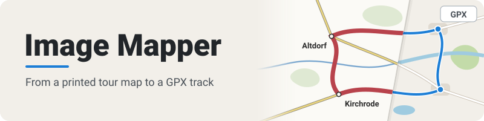

  

Take a tour printed in a magazine and carry it along as GPX. Image Mapper overlays a
photo or scan of a printed tour map on a web map, warps it into place, and lets you
trace the route and export it. It runs entirely in the browser; nothing is uploaded.

## Features

- **Georeferencing** — mark point pairs on the image and the map; a thin plate spline warps the image into place.
- **Match Towns** — a rough first placement from a few named towns, before any pairs are set.
- **Blend and recolour** — Multiply, Difference and recolouring read the map through the image and show misalignment.
- **Route tracing** — trace routes with OSRM for car, bike or foot, with straight-line legs where routing has no data.
- **Waypoints** — named places with optional descriptions, independent of the routes.
- **Measuring** — tap two points on the map for the distance between them.
- **GPX export** — all routes (one track each) and all waypoints in one file.
- **Many base maps** — raster and vector world maps, official regional maps, and an optional satellite overlay.
- **Local only** — stored in the browser's IndexedDB; save and reopen the whole project as a single `.imgmap` file.
- **Undo/redo, dark mode, phone layout** — session history, a light/dark toggle that follows the browser, and a foldaway panel.
